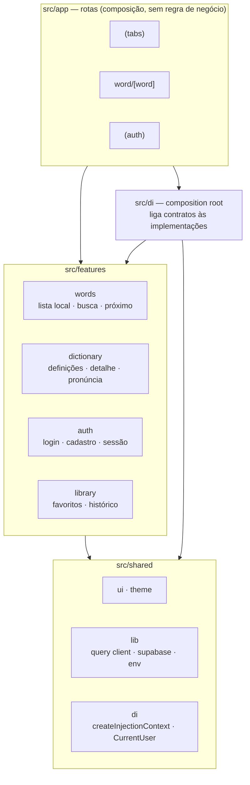
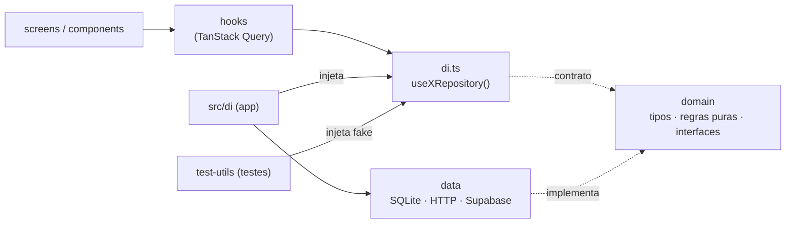
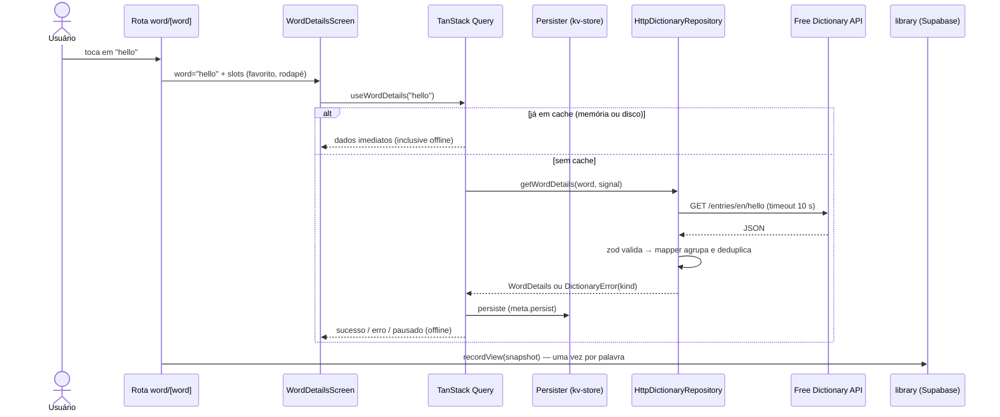
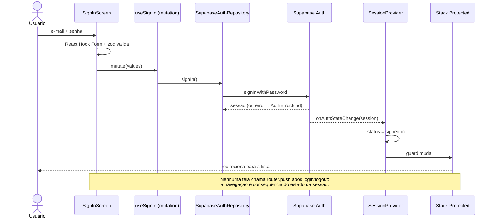
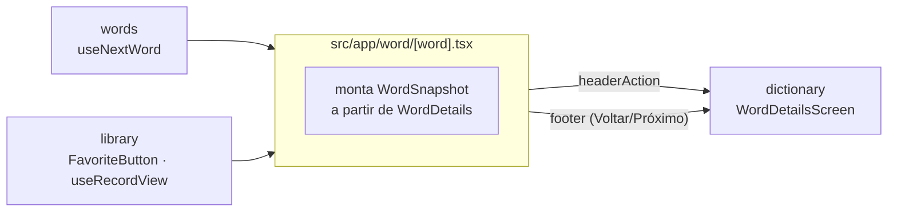

# Dicionário — English Words

Aplicativo mobile para explorar palavras em inglês, com significados, fonética, pronúncia em áudio, favoritos e histórico sincronizados por usuário.

> This is a challenge by [Coodesh](https://coodesh.com/)

## Sumário

- [Status](#status)
- [Tecnologias](#tecnologias)
- [Como executar](#como-executar)
- [Testes](#testes)
- [Arquitetura](#arquitetura)
- [Configuração do projeto](#configuração-do-projeto)
- [Base de palavras](#base-de-palavras)
- [Dicionário, cache e offline](#dicionário-cache-e-offline)
- [Autenticação e dados por usuário](#autenticação-e-dados-por-usuário)
- [Decisões técnicas](#decisões-técnicas)
- [Problemas encontrados](#problemas-encontrados)
- [Limitações e próximos passos](#limitações-e-próximos-passos)
- [Design](#design)

## Status

**Requisitos obrigatórios**

| Requisito                                      | Situação |
| ---------------------------------------------- | -------- |
| Lista de palavras com rolagem infinita         | ✅       |
| Visualizar palavra, significados e fonética    | ✅       |
| Salvar e remover favoritos                     | ✅       |
| Histórico de palavras vistas                   | ✅       |
| Cache das requisições                          | ✅       |
| Wireframe (lista + detalhe com Voltar/Próximo) | ✅       |

**Diferenciais**

| Diferencial                   | Situação | Como                                                     |
| ----------------------------- | -------- | -------------------------------------------------------- |
| 1 — Áudio                     | ✅       | mp3 da API com fallback para voz sintetizada do aparelho |
| 2 — Injeção de dependência    | ✅       | Contexts tipados + composition root, sem biblioteca      |
| 3 — Testes                    | ✅       | 142 testes + 2 fluxos E2E (Maestro)                      |
| 4 — Login e dados por usuário | ✅       | Supabase Auth + Postgres com Row Level Security          |

## Tecnologias

| Área              | Escolha                                                           |
| ----------------- | ----------------------------------------------------------------- |
| Base              | React Native 0.88, Expo SDK 58, TypeScript 6, Expo Router         |
| UI                | Restyle (tokens tipados), Lucide, Plus Jakarta Sans / Noto Sans   |
| Listas            | FlashList v2                                                      |
| Dados locais      | expo-sqlite (banco pré-construído), expo-sqlite/kv-store          |
| Estado assíncrono | TanStack Query (+ persister e onlineManager com NetInfo)          |
| Formulários       | React Hook Form + zod                                             |
| Backend           | Supabase (Auth + Postgres com RLS)                                |
| Áudio             | expo-audio, expo-speech                                           |
| Testes            | Jest (jest-expo), React Native Testing Library v14, Maestro (E2E) |
| Qualidade         | ESLint (com `import/order`), Prettier                             |

## Como executar

### Pré-requisitos

- Node 22+
- Xcode (iOS) e/ou Android Studio com emulador (Android)
- Um projeto [Supabase](https://supabase.com) (plano gratuito é suficiente)

### 1. Supabase

1. Crie um projeto no Supabase.
2. **SQL Editor** → execute o conteúdo de [`supabase/migrations/20261105120000_create_favorites_and_history.sql`](supabase/migrations/20261105120000_create_favorites_and_history.sql) (tabelas, índices e políticas RLS).
3. **Authentication → Sign In / Providers**: provider **Email** habilitado, **Allow new users to sign up** ligado e **Confirm email** desligado (permite entrar logo após o cadastro).
4. **Project Settings → API Keys / Data API**: copie a **Project URL** e a **Publishable key**.

### 2. Variáveis de ambiente

```bash
cp .env.example .env
```

Preencha `EXPO_PUBLIC_SUPABASE_URL` e `EXPO_PUBLIC_SUPABASE_PUBLISHABLE_KEY`. O app valida as variáveis na inicialização (zod) e **recusa chaves que não sejam publishable** — a `secret key` nunca deve ir para o app.

### 3. Rodar

```bash
npm install
npx expo run:ios      # ou: npx expo run:android
```

O projeto usa **Continuous Native Generation**: `ios/` e `android/` não são versionadas e são geradas a partir do `app.json` no primeiro `run`. É um development build (não usa Expo Go).

### Scripts

| Comando                  | O que faz                                                |
| ------------------------ | -------------------------------------------------------- |
| `npm start`              | Metro; também gera os tipos das rotas (`typedRoutes`)    |
| `npm test`               | Testes                                                   |
| `npm run typecheck`      | Checagem de tipos                                        |
| `npm run lint`           | ESLint + Prettier                                        |
| `npm run build:words-db` | Regenera `assets/db/words.db` a partir da lista original |

## Testes

**142 testes**, organizados por camada:

| Camada               | Como é testada                                                                                         |
| -------------------- | ------------------------------------------------------------------------------------------------------ |
| Regras puras         | Tabelas de casos (`it.each`): busca por prefixo, mapper da API, política de retry, agrupamento por dia |
| Repositório SQLite   | **SQL real** em banco em memória (`node:sqlite`) — valida a consulta, não a string                     |
| Repositórios remotos | `fetch` e cliente Supabase injetados: classificação de erros, timeout, cancelamento                    |
| Hooks                | `renderHook` com repositórios fake via DI (paginação, atualização otimista com rollback)               |
| Telas                | RNTL buscando por papel de acessibilidade (`findByRole('button', { name })`)                           |

As rotas (`src/app/`) ficam fora da cobertura: são composição; a lógica vive nas features.

### E2E (Maestro)

Fluxos em [`.maestro/`](.maestro/), executados no app real:

| Fluxo                  | Cobre                                                                     |
| ---------------------- | ------------------------------------------------------------------------- |
| `sign-up-and-sign-out` | Cadastro, login automático, rotas protegidas e logout                     |
| `favorite-and-history` | Login, busca, detalhe, favoritar, Favoritos, Histórico e remover favorito |

```bash
# instalar: curl -fsSL "https://get.maestro.mobile.dev" | bash
npx expo run:ios --configuration Release
npm run test:e2e -- -e E2E_EMAIL=<conta-de-teste> -e E2E_PASSWORD=<senha>
```

- A conta de teste deve começar **sem favoritos** (o fluxo favorita e remove, ficando idempotente).
- Elementos de ação usam `testID` (rótulos se repetem; identificadores não).
- No simulador iOS, desligue o AutoFill de senhas para evitar painéis do sistema sobre os campos.

## Arquitetura

### Princípios

1. **Organização por funcionalidade.** Cada feature (`words`, `dictionary`, `auth`, `library`) contém tudo o que precisa: contratos, implementações, hooks, componentes e telas.
2. **Dependências em uma direção.** Rotas compõem features; features dependem de `shared`; `shared` não conhece ninguém. Uma feature **nunca** importa outra.
3. **Domínio isolado de frameworks.** `domain/` não importa React, Supabase nem `fetch` — só tipos, regras puras e contratos. É o que torna as regras testáveis sem simular nada.
4. **Implementações substituíveis.** Telas e hooks dependem de contratos; o composition root decide se a implementação é SQLite, HTTP, Supabase ou um fake de teste.
5. **Proporcionalidade.** Sem use cases que só repassam chamadas, sem biblioteca de DI, sem estado global desnecessário — cada abstração existe porque resolve um problema concreto.

### Visão em camadas



### Camadas dentro de uma feature



| Pasta         | Responsabilidade                                                  | Pode importar           |
| ------------- | ----------------------------------------------------------------- | ----------------------- |
| `domain/`     | Modelos, regras puras, contratos (`interface XRepository`), erros | Nada de framework       |
| `data/`       | Implementações: SQL, HTTP + zod + mapper, Supabase                | `domain`, SDKs          |
| `hooks/`      | Estado assíncrono, cache, chaves de query, atualização otimista   | `domain`, `di`          |
| `components/` | UI da feature, sem buscar dados                                   | `shared/ui`             |
| `screens/`    | Orquestram hooks, estados (loading/erro/vazio) e navegação        | tudo da própria feature |
| `di.ts`       | Declara as dependências da feature (`createInjectionContext`)     | `domain`                |

### Fluxo de dados: abrir uma palavra



### Fluxo de autenticação



### Composição entre features (slots)

O detalhe da palavra precisa de dados de **três** features, sem que elas se conheçam. A rota faz a composição:



A tela do dicionário recebe `headerAction` e `footer` como _slots_ (`ReactNode`): ela não sabe que favoritos ou a lista existem. Da mesma forma, `CurrentUserBridge` no composition root lê a sessão (`auth`) e entrega apenas o id do usuário à `library`.

### Por que funções e não classes (e não Clean Architecture completa)

Repositórios são **factories que retornam objetos** que satisfazem uma interface, e não classes:

```ts
export function createSqliteWordsRepository(db: WordsDatabase): WordsRepository {
  return {
    async listWords({ limit, cursor, prefix }) {
      /* ... */
    },
  };
}
```

| Critério                  | Factory + closure                                                                   | Classe                                                           |
| ------------------------- | ----------------------------------------------------------------------------------- | ---------------------------------------------------------------- |
| Estado / herança          | Não há estado mutável nem hierarquia — a closure guarda só as dependências          | Recursos (herança, `this`, visibilidade) que não seriam usados   |
| `this`                    | Inexistente: métodos podem ser passados como callback sem `bind`                    | Perder o `this` ao repassar um método é um bug clássico          |
| Contrato                  | A interface é a fonte de verdade; o TypeScript checa o objeto retornado             | `implements` faz o mesmo, com mais cerimônia                     |
| Testes                    | Injeta-se a dependência como argumento (`db`, `fetchFn`, `auth`); fakes são objetos | Exige construtor/mocks de classe                                 |
| Ecossistema React         | Mesmo estilo de hooks e componentes (funções)                                       | Mistura de paradigmas                                            |
| Decorators / DI de classe | Desnecessários                                                                      | Inversify/tsyringe exigem `reflect-metadata` (atrito com Hermes) |

Classes aparecem apenas onde agregam: os erros de domínio (`DictionaryError`, `AuthError`) estendem `Error` para manter stack trace e permitir `instanceof` como _type guard_.

**Sobre Clean Architecture:** aplicamos seus princípios — domínio independente de frameworks, dependências apontando para dentro, implementações substituíveis — sem a cerimônia completa. Use cases foram omitidos porque, neste escopo, cada um seria uma função que apenas repassa a chamada ao repositório; os hooks já fazem o papel de camada de aplicação (cache, retry, atualização otimista). Se surgissem regras que orquestram vários repositórios, um use case passaria a se justificar.

### Injeção de dependência

Cada feature declara o que precisa com `createInjectionContext<T>()` — um Context tipado que **falha imediatamente** se o provider estiver ausente. O composition root (`src/di/`) fornece as implementações reais; `test-utils` fornece fakes com a mesma árvore de providers.

InversifyJS/tsyringe foram descartados: dependem de decorators e `reflect-metadata` (atrito com Babel/Hermes) para um ganho que o Context já entrega.

## Configuração do projeto

### Estrutura de pastas

```
.
├── .maestro/                    fluxos E2E (Maestro)
├── assets/db/words.db           base de palavras pré-construída (5,1 MB)
├── docs/                        design (HTML) e enunciado
├── scripts/build-words-db.mjs   gera o words.db (node:sqlite, sem dependências)
├── supabase/migrations/         SQL versionado (tabelas + RLS)
└── src/
    ├── app/                     rotas (Expo Router)
    ├── di/app-dependencies.tsx  composition root
    ├── features/
    │   ├── words/               SQLite · paginação por cursor · busca · próximo
    │   ├── dictionary/          API · zod · mapper · detalhe · skeleton · pronúncia
    │   ├── auth/                Supabase Auth · sessão · formulários
    │   └── library/             favoritos · histórico · snapshot
    ├── shared/
    │   ├── theme/               paleta, tokens claro/escuro, fontes
    │   ├── ui/                  Box, Text, Button, TextField, Screen, Skeleton…
    │   ├── lib/                 query client, persister, online manager, supabase, env
    │   ├── database/            configuração do SQLite
    │   ├── di/                  createInjectionContext, CurrentUser
    │   ├── hooks/               useDebouncedValue
    │   └── providers/           AppProviders
    └── test-utils/              renderWithProviders / renderHookWithProviders
```

### Rotas (Expo Router)

```
src/app/
├── _layout.tsx           fontes · splash · providers · Stack com Stack.Protected
├── (auth)/               só deslogado  → se logado, redirectTo "/"
│   ├── sign-in.tsx
│   └── sign-up.tsx
├── (tabs)/               só logado     → se deslogado, redirectTo "/sign-in"
│   ├── _layout.tsx       header + seletor segmentado (expo-router/ui, headless)
│   ├── index.tsx         Palavras
│   ├── history.tsx       Histórico
│   └── favorites.tsx     Favoritos
└── word/[word].tsx       detalhe, empilhado sobre as abas (protegido)
```

| URL                    | Tela                                            |
| ---------------------- | ----------------------------------------------- |
| `/`                    | Palavras (grid + busca)                         |
| `/history`             | Histórico                                       |
| `/favorites`           | Favoritos                                       |
| `/word/hello?q=hel`    | Detalhe; `q` mantém o "Próximo" dentro da busca |
| `/sign-in`, `/sign-up` | Autenticação                                    |

- Grupos `(…)` organizam sem aparecer na URL.
- `typedRoutes` tipa `router.push` — uma rota inexistente não compila.
- Arquivos de rota só reexportam telas das features (exceto `word/[word]`, que compõe três features).
- "Próximo" usa `router.replace`: avançar várias palavras não empilha telas.

### Árvore de providers

```
SafeAreaProvider
└── PersistQueryClientProvider       cache + persistência opt-in (kv-store)
    └── SQLiteProvider                abre words-v1.db (copiado do bundle)
        └── ThemeProvider             claro/escuro conforme o sistema
            └── AppDependencies       composition root
                ├── Words/Dictionary/Library/Auth repository providers
                └── SessionProvider → CurrentUserBridge
                    └── RootNavigator (splash até resolver a sessão · Stack.Protected)
```

### Estado e dados

| Dado                  | Onde vive                | Ferramenta                          | Persistência                   |
| --------------------- | ------------------------ | ----------------------------------- | ------------------------------ |
| Lista de palavras     | SQLite (somente leitura) | `useInfiniteQuery`                  | arquivo do app                 |
| Definições            | Free Dictionary API      | `useQuery` + retry + persister      | kv-store (1 semana)            |
| Favoritos e histórico | Supabase (RLS)           | `useQuery` / `useMutation` otimista | servidor                       |
| Sessão                | Supabase Auth            | `SessionProvider` (Context)         | kv-store, renovação automática |
| Formulários           | componente               | React Hook Form + zod               | —                              |
| UI local (aba, busca) | componente               | `useState`                          | —                              |

### Tema e design system

- **Restyle** com tokens em duas camadas: `palette` (valores crus) → `colors` (papéis semânticos). Telas usam apenas tokens; nenhum hex.
- **Dark mode**: `darkColors: typeof lightColors` garante paridade de tokens em tempo de compilação; o tema troca ao vivo com `useColorScheme`.
- **Tipografia**: variantes (`display`, `word`, `body`, `phonetic`…), uma família de fonte por peso (e itálico) — no Android, `fontWeight` não seleciona arquivo de fonte customizada.
- **Primitivos** em `shared/ui`: `Box`, `Text`, `Icon`, `Button`, `IconButton`, `TextField`, `FormTextField`, `Card`, `Screen`, `Skeleton`, `StateMessage`.

### Qualidade e ferramentas

| Ferramenta     | Configuração                                                                       |
| -------------- | ---------------------------------------------------------------------------------- |
| TypeScript 6   | `strict`; `types: ["jest", "node"]` explícitos; tipos do banco gerados do Supabase |
| ESLint         | `eslint-config-expo` + Prettier + `import/order` (externos → `@/` → `../` → `./`)  |
| Prettier       | aspas simples, `printWidth` 100; VS Code formata e corrige ao salvar               |
| Jest           | `jest-expo`; mapper do Lucide para CJS; FlashList em `transformIgnorePatterns`     |
| React Compiler | habilitado (`experiments.reactCompiler`)                                           |
| Maestro        | fluxos E2E com `testID` nos elementos de ação                                      |

### Configuração nativa (`app.json`)

- **Continuous Native Generation**: `ios/` e `android/` não são versionadas; o `app.json` é a fonte única.
- **Plugins**: `expo-router`, `expo-splash-screen`, `expo-font`, `expo-sqlite`, `expo-audio`.
- `userInterfaceStyle: "automatic"` (dark mode), `typedRoutes`, `reactCompiler`.

### Variáveis de ambiente

| Variável                               | Descrição                          |
| -------------------------------------- | ---------------------------------- |
| `EXPO_PUBLIC_SUPABASE_URL`             | URL do projeto Supabase            |
| `EXPO_PUBLIC_SUPABASE_PUBLISHABLE_KEY` | Chave pública (`sb_publishable_…`) |

Validadas com zod na inicialização; uma chave que não seja publishable impede o app de iniciar.

## Base de palavras

A Free Dictionary API não lista palavras; a lista vem de [`dwyl/english-words`](https://github.com/dwyl/english-words) (~370 mil).

| Opção                        | Problema                                                                |
| ---------------------------- | ----------------------------------------------------------------------- |
| `import` do JSON no bundle   | Parse de vários MB na thread JS no startup; dezenas de MB fixos no heap |
| JSON carregado em runtime    | Mesmo custo de memória; busca vira `filter` linear a cada tecla         |
| Tabela remota                | Dado estático dependendo de rede a cada página                          |
| **SQLite pré-construído** ✅ | Dados em disco, consultas por índice, offline, abertura instantânea     |

O script [`scripts/build-words-db.mjs`](scripts/build-words-db.mjs) gera `assets/db/words.db` com o SQLite embutido no Node, sem dependências.

- **Tabela `WITHOUT ROWID`** com `word` como chave primária: a tabela é o próprio índice.
- **Paginação por cursor** (`word > :cursor`), custo constante em qualquer profundidade (ao contrário de `OFFSET`).
- **Busca por prefixo como intervalo** (`word >= 'hel' AND word < 'hem'`), que usa o índice — `LIKE` normalmente não.
- **`LIMIT n + 1`** indica se há próxima página sem `COUNT`.
- **Nome versionado** (`words-v1.db`) força a cópia de uma base atualizada.

| Medição                             | Valor                                      |
| ----------------------------------- | ------------------------------------------ |
| Palavras                            | 370.098 (3 entradas inválidas descartadas) |
| Tamanho                             | 5,1 MB                                     |
| `COUNT(*)` + página (iOS / Android) | ~13 ms / ~19 ms                            |
| `EXPLAIN QUERY PLAN` da paginação   | `SEARCH words USING PRIMARY KEY (word>?)`  |

## Dicionário, cache e offline

- **Validação na fronteira:** a resposta da API passa por zod e por um mapper puro (agrupa classes gramaticais repetidas entre entradas, deduplica fonética, identifica sotaque pelo nome do mp3).
- **Erros de domínio** (`not-found`, `server`, `network`, `timeout`, `invalid-response`): a tela nunca inspeciona status HTTP; um `switch` exaustivo escolhe a mensagem.
- **Retry só para falhas transitórias** (`server`, `network`), no máximo 2; timeout de 10 s não é repetido.
- **Cache persistido** (Obrigatório 2): `PersistQueryClientProvider` sobre `expo-sqlite/kv-store`. A persistência é **opt-in** via `meta: { persist: true }` — só definições são gravadas; a lista de palavras já está no SQLite.
- **Offline:** `onlineManager` ligado ao NetInfo (conectado **e** internet alcançável). Sem rede, a consulta pausa, a tela mostra "Você está offline" e **retoma sozinha** quando a conexão volta. Palavras já vistas abrem offline.
- **Pronúncia:** mp3 da API (prioridade US → UK → AU); se não houver áudio ou o arquivo não carregar em 6 s, usa a **voz sintetizada** do aparelho.

## Autenticação e dados por usuário

- **Supabase Auth** (e-mail e senha). Senhas ficam em `auth.users` como **hash bcrypt**, gerenciadas pelo Supabase; o app nunca armazena senha.
- **Sessão persistida** no aparelho e renovada automaticamente (pausada em segundo plano via `AppState`).
- **Rotas protegidas** com `Stack.Protected` + `redirectTo`. **Nenhuma tela navega após login/logout**: a navegação é consequência do estado da sessão. A splash só some quando a sessão é resolvida (sem "piscar" o login).
- **Logout com `scope: 'local'`**: sai deste aparelho e funciona offline.
- **Banco** ([migration](supabase/migrations/20261105120000_create_favorites_and_history.sql)): `favorites` e `history` com chave `(user_id, word)`, snapshot da palavra para listar sem consultar a API, `check` na palavra e **RLS por operação** (`(select auth.uid()) = user_id`, `to authenticated`). Advisors de segurança do Supabase sem alertas.
- **Cache por usuário:** as chaves incluem o id (`['library', 'favorites', userId]`), então trocar de conta nunca exibe dados da anterior.
- **Favoritar é otimista** com rollback se o servidor falhar.

## Decisões técnicas

| Decisão                                   | Motivo                                                                                        | Alternativa descartada                     |
| ----------------------------------------- | --------------------------------------------------------------------------------------------- | ------------------------------------------ |
| Apenas mobile                             | Escopo da vaga; SQLite e áudio exigiriam tratamento específico na web                         | `react-native-web`                         |
| Continuous Native Generation              | `app.json` como fonte única da config nativa                                                  | Versionar `ios/` e `android/`              |
| Sem Zustand                               | Não há estado global de cliente: remoto no TanStack Query, lista no SQLite, sessão em Context | Zustand                                    |
| Restyle com tokens semânticos             | Tema tipado; nenhum hex nas telas                                                             | StyleSheet + constantes                    |
| Uma família de fonte por peso (e itálico) | No Android, `fontWeight`/`fontStyle` não selecionam arquivo de fonte customizada              | Embutir via plugin                         |
| TanStack Query também para dados locais   | Paginação, estados uniformes e cache entre telas                                              | `useState` manual                          |
| Abas headless (`expo-router/ui`) no topo  | Design pede seletor segmentado; sem biblioteca extra                                          | Tab bar inferior                           |
| Busca abaixo das abas                     | Abas não mudam de posição entre telas (o enunciado permite reposicionar)                      | Busca entre header e abas                  |
| React Hook Form + zod                     | Validação tipada de ponta a ponta e estado de formulário pronto                               | `useState` + validação manual              |
| Persistência do cache opt-in por `meta`   | `shared` não conhece features; nenhuma feature é persistida por acidente                      | Excluir chaves por nome                    |
| Feature `library` única                   | Favoritos e histórico compartilham snapshot, repositório e padrão de chaves                   | Duas features duplicadas                   |
| Voz sintetizada como fallback de áudio    | Nativa, offline, sem chave de API                                                             | ResponsiveVoice                            |
| Sessão no `kv-store`                      | Simples e suficiente para o desafio (área privada do app)                                     | SecureStore (limite de tamanho no Android) |
| Dark mode pelo tema do sistema            | Paleta escura nos mesmos tokens semânticos (paridade checada pelo TypeScript)                 | Tema fixo claro                            |
| Tradução das definições                   | Não pedida; exigiria API externa, custo e latência; o app é "inglês → significados"           | Traduzir para português                    |

## Problemas encontrados

| Problema                                           | Causa                                                                                                                                                  | Solução                                                                                                                                   |
| -------------------------------------------------- | ------------------------------------------------------------------------------------------------------------------------------------------------------ | ----------------------------------------------------------------------------------------------------------------------------------------- |
| `render function has not been called`              | RNTL v14: `render`, `renderHook` e `fireEvent` são assíncronos                                                                                         | `await` em todas as chamadas                                                                                                              |
| `Cannot find name 'describe'` / `'node:sqlite'`    | TypeScript 6 assume `"types": []`                                                                                                                      | `"types": ["jest", "node"]`                                                                                                               |
| Hook não re-renderizava após `fetchNextPage`       | _Tracked queries_: só re-renderiza por propriedades lidas antes                                                                                        | `waitFor` na propriedade que muda                                                                                                         |
| `Must use import to load ES Module`                | Lucide resolvido para `.mjs`; FlashList só ESM                                                                                                         | `moduleNameMapper` / `transformIgnorePatterns`                                                                                            |
| Rota "não existe" no TypeScript                    | `typedRoutes` só regenera com o Metro rodando                                                                                                          | Manter `npm start` ao criar rotas                                                                                                         |
| `Element type is invalid … WrappedScreenComponent` | Arquivo de rota vazio, sem `export default`                                                                                                            | Restaurar o export                                                                                                                        |
| "helluo" sempre retorna 502 em HTML                | Instabilidade do servidor da API (Cloudflare)                                                                                                          | Erro `server` honesto com retry e link para o Wiktionary                                                                                  |
| Skeleton por ~33 s offline                         | `fetch` pendurado até o timeout, repetido 3 vezes                                                                                                      | NetInfo + estado pausado; timeout não é repetido                                                                                          |
| Avisos `act(...)` em testes                        | Asserções cedo demais / consulta pausada retomando após o teste                                                                                        | `waitFor` no estado final; `cleanup()` antes de `setOnline(true)`                                                                         |
| `Invalid API key`                                  | Chave copiada incompleta (39 de 46 caracteres)                                                                                                         | Copiar pelo botão do painel                                                                                                               |
| Cadastro falhava com mensagem genérica             | `email_provider_disabled`: cadastros desligados no painel (diagnosticado nos logs via MCP)                                                             | Reativar "Allow new users to sign up"                                                                                                     |
| "Unmatched Route" deslogado                        | `Stack.Protected` sem destino de redirecionamento                                                                                                      | `redirectTo` explícito nos dois grupos                                                                                                    |
| Áudio preso em "Carregando…"                       | Servidor de mídia da API retornando 502                                                                                                                | Fallback automático para voz sintetizada após 6 s                                                                                         |
| Offline não retomava no iOS após religar o Wi-Fi   | Simulador iOS não entrega de forma confiável os eventos de rede; `NetInfo.refresh()` devolve `isInternetReachable` anterior à verificação (assíncrona) | Botão "Tentar novamente" no estado offline retoma as consultas (`onlineManager.setOnline(true)`) e deixa a requisição confirmar a conexão |
| "Próximo" desabilitado offline                     | Consultas locais (SQLite) usavam `networkMode: 'online'` e pausavam sem internet                                                                       | `networkMode: 'always'` nas consultas locais                                                                                              |
| `INSTALL_FAILED_INSUFFICIENT_STORAGE` (Android)    | Partição do emulador pequena para o APK de debug                                                                                                       | Aumentar o armazenamento do AVD + Wipe Data                                                                                               |

## Limitações e próximos passos

Escopo deixado de fora conscientemente, priorizando os requisitos e a qualidade do que foi entregue:

- **Recuperação de senha:** exige deep link e tela de redefinição.
- **Marcadores "vista/favorita" no grid, deslizar para excluir e animações** (ex.: pulso no skeleton).
- **Sessão criptografada** (SecureStore + chave para dados grandes).
- **Projeto Supabase gratuito pausa após 7 dias sem uso:** se o login falhar, reative o projeto no painel ou crie o seu com a migration acima.
- **Jest:** aviso intermitente "worker process failed to exit gracefully" (não afeta resultados) a investigar.

## Design

Telas de referência em [`docs/design/`](docs/design/) (abra `index.html` no navegador). Enunciado original em [`docs/challenge/challenge.md`](docs/challenge/challenge.md).
